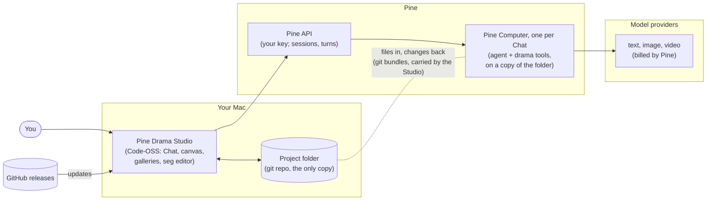
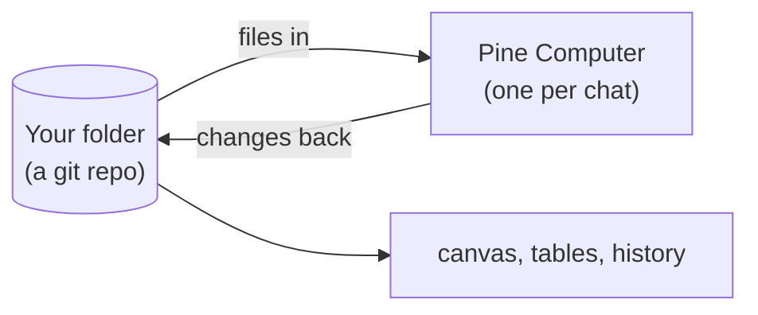
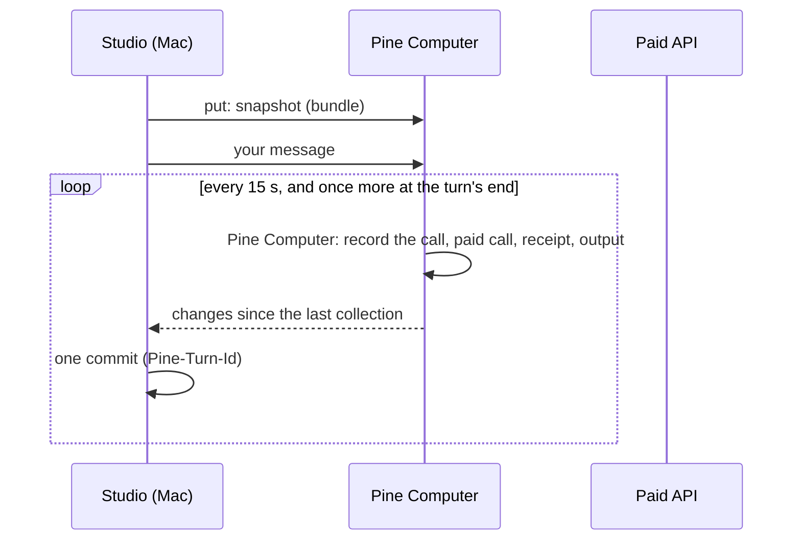

# Pine Drama Studio architecture

For developers. To make a drama, see [quick-start.md](quick-start.md).

## The system

The drama tools run on Pine Computer.

## 1. The picture

The folder is the drama. A chat's Computer works on a copy and sends back what changed.

## 2. Compared

| | Codex CLI | Codex cloud | Claude Code local | Claude Code web | **Pine Drama Studio** |
|---|---|---|---|---|---|
| Runs on | your machine | a cloud workspace | your machine | a cloud VM | a Pine Computer per chat |
| Starts from | your folder | a branch + local diff | your folder | your branch on GitHub | a snapshot of your folder |
| Changes land | as written | one diff, applied by you | as written | a pushed branch | live: a commit per collection |
| Conflicts | a stale patch fails | `git apply --3way` | — | at merge | per file, 3-way |
| Approves | before each action | you pick a diff | before each action | you merge | five stops (in the skill) |
| Stop | written stays | — | written stays | — | written is collected |
| Undo | your git | your git | `/rewind` | your git | "Use" a past result |
| Money | — | — | — | — | a record before each paid call |

Closest: Codex cloud. Ours brings results back live and records every paid call.

## 3. A turn

## 4. Trade-offs

A file changed on one side keeps that change. Changed on both, the turn's version lands, and yours is committed first, so both stay in history ([git's 3-way merge](https://git-scm.com/docs/git-merge-file)).

| Choice | Why | Cost |
|---|---|---|
| Per-file 3-way | Media files don't merge line by line | Changed on both sides: the turn's version lands, yours stays in history |
| No lock across chats | Chats are peers | Same picture in two chats: paid twice |
| Stops live in the skill | Habits differ | The client doesn't enforce them |
| No budget in the Studio | Pine bills and caps calls | No local cap |
| A commit per collection | Results show live and history is exact | A turn spans several commits (each carries Pine-Turn-Id) |

### Known limits

| Limit | When |
|---|---|
| Uncollected results lost | The Computer stops before a Studio collects |
| A new chat uploads everything | Its Computer has no history yet (~40 s for 509 MB) |
| A receipt without its output | A disk write fails between them ([#242](https://github.com/PineComputer/pine-drama-studio/issues/242)) |
| Chats lost after moving the folder | Turns are keyed by the folder's path |

## 5. One entry point per action

| Action | Function |
|---|---|
| Edit, delete, add, import, "Use" | `runCardAction` → `applyPersonChange` → `commitIndexPaths` |
| Turn starts | `putTurnFiles` |
| Turn runs / ends | `collectTurn` → `landTurnFiles` |
| Stop | `stopTurn` |
| Studio starts | `resumeUnfinishedTurnFollowUps` |
| Any view | `readProjectFromFolder` |
| "Generate" on a card | fills the open chat; sends nothing |

## FAQ

| Question | Answer |
|---|---|
| Why a Pine Computer, not my machine? | **Many chats in parallel, and work goes on while your Mac sleeps.** Each chat gets its own Computer; the paid calls and their records run there. |
| How do several chats make one drama? | **Each works on its own copy; changes come back by git.** Each file follows git's per-file 3-way rule; history keeps every version. |
| Is a Computer shared? Who sees my data? | **One per chat, in your Pine project.** Pine has completed SOC 2; request the report at [trust.19pine.ai](https://trust.19pine.ai) ("Get access"). |
| Which models? Can I add one? | **Pine Computer picks them; you choose a preset, which names one model set.** Each set is one tested combination. See [presets](presets.md). |
| How is this different from Codex cloud or Claude Code web? | **Same shape, plus live results and paid-call records.** See [Compared](#2-compared). |
| Why a VS Code fork? | **Native chat, editors and updates come free.** The Studio is built on [Code-OSS](https://github.com/microsoft/vscode). |
| Two chats draw the same picture: do I pay twice? | **Yes.** No lock across chats; the later lands, the earlier stays in history. |
| Why git, not our own versions? | **Git already moves, diffs and keeps history.** Versions, a choices file and acceptance are gone. |
| Does Stop lose work? | **No.** What was written is still collected. |
| I close the Studio mid-turn? | **Nothing is lost** unless the Computer idles out first; the next start picks the turn up ([#239](https://github.com/PineComputer/pine-drama-studio/pull/239)). |

## References

- [Pine Drama protocol](protocol.md) · [presets](presets.md)
- Pine Computer: [how a Computer works](https://console.pinecomputer.io/docs/how-a-computer-works), [sessions](https://console.pinecomputer.io/docs/sessions), [agent turns](https://console.pinecomputer.io/docs/agent), [limits](https://console.pinecomputer.io/docs/limits) · [Trust Center](https://trust.19pine.ai)
- Codex: [cloud](https://learn.chatgpt.com/docs/cloud), [source](https://github.com/openai/codex)
- Claude Code: [checkpointing](https://code.claude.com/docs/en/checkpointing), [permissions](https://code.claude.com/docs/en/permissions), [on the web](https://code.claude.com/docs/en/claude-code-on-the-web)
- Git: [bundle](https://git-scm.com/docs/git-bundle), [objects](https://git-scm.com/book/en/v2/Git-Internals-Git-Objects)
- [Code-OSS](https://github.com/microsoft/vscode)
