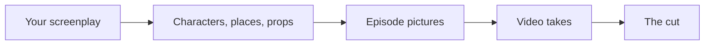
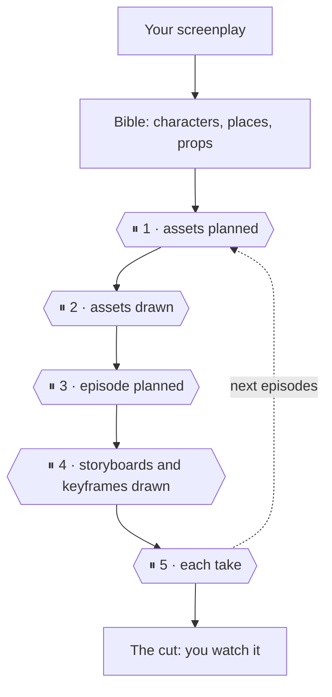
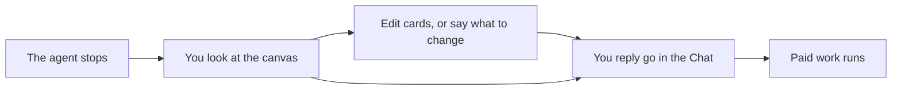

# Quick Start

You bring a screenplay. An agent makes the drama, and you say go at each step.

| Step | What you do |
|---|---|
| 1 | Get a Pine key at [console.pinecomputer.io](https://console.pinecomputer.io), then paste it in **Accounts › Pine Computer…** |
| 2 | **File › New Project**, choose an empty folder, and drop in your screenplay |
| 3 | Talk to the agent in the Chat |

## 1. Make a drama

The agent stops at ⏸ and works on its own everywhere else.

Your reply is the go: nothing at a stop asks you to approve item by item.

| Stop | You look at | Your choice |
|---|---|---|
| 1 | The planned asset cards, each with its description | Add, remove or change an asset, in one sentence |
| 2 | The drawn assets, with what the agent found | The leads' looks |
| 3 | The episode's shot list and its planned cards | Revise it, or go |
| 4 | Storyboards, keyframes, video prompts, and the estimated video cost | Shoot everything, or hold some back |
| 5 | Each take | Your verdict |

The agent also stops for a red line in the screenplay, and for a screenplay it rewrote.

## 2. Where things are

| Place | What's there | What you do |
|---|---|---|
| **Right: Chat** | The agent | Ask, answer, say go, press Stop |
| **Center: canvas** | One canvas for the assets, one per episode | Edit an asset's description, drop your picture on it, click an old version and press **Use** |
| **Center: galleries** | Characters, places, props | **Create New**; click a card to see it on the canvas |
| **Center: seg editor** | An episode's segments and takes | Play takes; **Generate** writes the request into the Chat for you to send |
| **Left: Production** | The project and each object's versions | Look and open only |
| **Bottom** | Diagnostics | Read what went wrong |

## 3. Design principles

How and why: [architecture](architecture.md).

| Principle | Borrowed from | What it means for you |
|---|---|---|
| The folder on your Mac is the only copy | [VS Code: open a folder](https://code.visualstudio.com/docs/editor/workspaces/workspaces) | Back it up like any folder |
| History keeps every result | [git log](https://git-scm.com/docs/git-log), [git restore](https://git-scm.com/docs/git-restore) | Press **Use** on any old version |
| Every Chat is a peer | [Claude Code: parallel sessions](https://code.claude.com/docs/en/common-workflows#run-parallel-sessions-with-worktrees) | Open as many Chats as you like |
| The work runs on a Pine Computer | [Codex cloud](https://learn.chatgpt.com/docs/cloud): "can keep working while your computer is asleep" | Close the laptop; results land when the Studio opens |
| Warn, don't block | [ESLint: warnings don't fail](https://eslint.org/docs/latest/use/configure/rules) | You see the agent's findings; it stops only for red lines and money |
| Reroll, don't constrain | Our own rule | The agent never redraws on its own; you reroll with your notes |
| Stops are instructions, not code | [Claude Code: skills](https://code.claude.com/docs/en/skills) | The agent stops where its instructions say |

## 4. Deliberate trade-offs

| Behaviour | Why it's deliberate | What you take care of |
|---|---|---|
| Two Chats make the same card at once: both pay, the later shows, the earlier stays in history | As with two coding agents in one repository: no locks between Chats | Give each Chat its own part: an episode, or a set of assets |
| A file changed on one side keeps that change; changed on both, the agent's version lands and yours is kept in history first ([git's 3-way merge](https://git-scm.com/docs/git-merge-file)) | Nothing is refused; history keeps every version | Edit a card after the agent's turn on it ends |
| The Studio sets no budget | Pine bills and caps each call | Turn on the setting `pineDrama.chat.showTurnCost` to see each turn's cost |
| The stops are the agent's instructions | The Studio doesn't check what follows your go | Say go once you've looked; at stop 4 you can hold segments back |
| Stop cancels at once | You can always stop | A call cut off counts as paid; going on draws it again |
| Your own pictures are used as they are | They're yours to judge | Check them before you say go |

## 5. When something goes wrong

| Symptom | What happens | What you do |
|---|---|---|
| Wi-Fi drops during a turn | The turn goes on; the Studio retries for up to 3 h | Nothing; after 3 h, click **Reload Window** in the Chat |
| You quit the Studio or closed the laptop during a turn | The Studio picks up every running Chat when it opens | Reopen within an hour of the work ending |
| You answer hours after a question | The Computer may have stopped | Send your answer; the agent starts again from your folder |
| The Chat is dead after Stop | Known bug | Run **Developer: Reload Window** |
| A card you made with Create New can't be drawn | Its name has a space, dash or accent (known bug) | Use a name in plain letters a–z, or ask the agent to add it |
| A turn failed | What it made still lands; Pine gives the reason | Ask the agent to go on |

## 6. FAQ

**Where do I get a key?**
At [console.pinecomputer.io](https://console.pinecomputer.io): make a project key (`pk_…`).
Paste it in **Accounts › Pine Computer…**; it's kept in your system's secret storage.

**Why make videos on a Pine Computer instead of my own?**
Nothing to install, and many Computers work at once.
Every Chat gets its own Computer with the tools and models; Pine bills each call, so you need no model keys.

**How is this different from the canvases of Higgsfield or LibTV?**
Here an agent makes the whole drama, from your screenplay to the cut, and asks you at five stops.
Every file and every earlier version stay in one folder on your Mac.

**Which models do you use?**
Pine Computer picks them. You choose a preset, and each preset names one model set.
We tested many combinations; each model set is one tested combination, drawing on GPT, Claude, Gemini, Grok, Seed, Seedream, Seedance, Wan and Deepgram.
Name a built-in preset to the agent, or add your own under `inputs/preset/` ([presets](presets.md)).

**Can I use my own cast or pictures?**
Yes: drop your picture on the card.
It's used as it is, and everything drawn from that card then uses it.

**Will others see my data? Is the Computer shared?**
No: each Chat runs on its own Computer, inside your Pine project.
Pine has completed SOC 2; request the report at [trust.19pine.ai](https://trust.19pine.ai) (**Get access**).

**How do I make several episodes at once?**
Open a Chat per episode, after the shared assets are drawn.
Each Chat has its own Computer; give each its own episodes, so no two draw the same card.

**What does it cost, and who pays?**
Your Pine organization pays, from its credits.
The agent shows the estimated video cost before any take; prices are in your Pine account.

**Will the agent spend money without asking?**
No: it asks at the five stops first.
A card's **Generate** only writes into the Chat; your send is the go.

**I liked an older picture. Can I get it back?**
Yes: click it in the card's version strip, then **Use**.
History keeps every result.

## References

- [Protocol](protocol.md), [vocabulary](vocabulary.md), [presets](presets.md), [architecture](architecture.md)
- [Pine Computer: agent turns](https://console.pinecomputer.io/docs/agent), [limits](https://console.pinecomputer.io/docs/limits)
- [Pine trust center](https://trust.19pine.ai)
- [Fountain screenplay syntax](https://fountain.io/syntax)
- [VS Code: workspaces](https://code.visualstudio.com/docs/editor/workspaces/workspaces)
- [git log](https://git-scm.com/docs/git-log), [git restore](https://git-scm.com/docs/git-restore)
- [Codex cloud](https://learn.chatgpt.com/docs/cloud)
- [Claude Code: parallel sessions](https://code.claude.com/docs/en/common-workflows#run-parallel-sessions-with-worktrees), [skills](https://code.claude.com/docs/en/skills)
- [ESLint: rule severities](https://eslint.org/docs/latest/use/configure/rules)
- [Higgsfield canvas](https://higgsfield.ai/canvas), [LibTV](https://www.liblib.tv)
